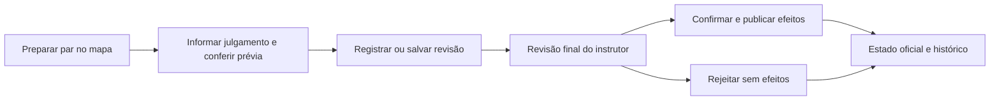

# 103 — Roteiro do instrutor: disposição das forças e confronto

**Atualizado em 2026-11-17 pela entrega [116](116_ENTREGA_JULGAMENTO_DIDATICO_NO_MAPA.md).** Versão parcial com julgamento didático, prévia, confirmação/rejeição e consulta dos efeitos no mapa ATLANTICADOR. “Preparar confronto” somente confere o par; o resultado oficial depende da confirmação explícita do instrutor. Confronto automático entre grupamentos ainda não está integrado.

## O que está disponível e o que ainda falta

| Etapa | Situação |
|---|---|
| Plotar/reposicionar meios adjudicados no mapa | Disponível, com regras existentes |
| Criar, consultar, selecionar, enquadrar e arquivar grupamentos elegíveis | Implementado e verificado na prévia isolada da entrega 102 |
| Preparar dossiê inicial AZUL/VERMELHO com snapshots | Backend de 98 conectado à conferência gráfica em 108; referências iniciais, posições de planejamento e hashes separados |
| Executar ensaio temporal de dois grupamentos | Ainda não integrado; o ensaio CPC existente é de unidades individuais e parâmetros sintéticos |
| Reproduzir eventos do confronto no mapa | Concepção em 97; ainda não implementada |
| Julgamento didático, confirmação/rejeição e efeitos oficiais | Implementado e verificado no navegador isolado em 116; histórico persistente |

Código instalado e processo ativo são coisas diferentes. A entrega gráfica pode ser conferida na prévia de teste; o servidor principal em 8787 não é reiniciado automaticamente. O roteiro pressupõe uma instância atualizada com as abas Grupos e CPC. A prévia de 116 usa dados sintéticos de teste, não os meios do exercício principal. Abra a raiz de `http://localhost:61269/` com usuário 1 e senha `somente-teste-local`, depois `/atlanticador/editor.html`. A porta depende do harness em execução; comandos para recriar estão no README do protótipo.

## Parte A — Passos que o instrutor já pode seguir na prévia

1. **Entrar com perfil de instrutor.** Conferir exercício e perfil antes de abrir o mapa. Se o seletor de partido estiver bloqueado em AZUL ou VERMELHO, a sessão é de operador; ela não permite organizar ou consultar livremente o adversário.
2. **Abrir o mapa ATLANTICADOR existente.** Usar a aba “Meios” do painel para consultar os meios adjudicados ao partido. Plotar por clique/coordenadas ou reposicionar pelas ferramentas anteriores quando necessário. Criar um grupo não posiciona os seus integrantes automaticamente.
3. **Escolher o partido no seletor “Partido SISCAN”.** O instrutor pode alternar AZUL/VERMELHO. Cada troca atualiza lista/realce; não junta inventários dos dois partidos. A seleção de grupo não é o agrupamento de camadas do editor.
4. **Abrir a aba “Grupos” (nome acessível: “Grupamentos”).** Em “Nova composição”, informar designação, domínio e integrantes elegíveis; acionar “Criar grupamento”. Unidade sem instância/snapshot/domínio demonstrado aparece pendente ou indisponível. O catálogo técnico completo não representa automaticamente unidades prontas para agrupamento; a integração atual reconhece a configuração aérea sintética controlada.
5. **Conferir o grupo criado.** Selecioná-lo na lista para realçar os marcadores já plotados. “Enquadrar integrantes” altera apenas a câmera. A lista mostra nomes/códigos do cadastro, posição disponível e pendências; clicar num integrante abre a consulta no painel. “Sem posição” não significa perda ou ausência de meio.
6. **Repetir para o outro partido.** Para liberar integrantes de um grupo, usar “Arquivar grupamento” e “Confirmar arquivamento”. Para recompor, arquivar e criar outro; não há edição gráfica dos membros. Na primeira abertura da prévia 116 existem grupos sintéticos; após reinício, crie novas composições pela interface. Os resultados oficiais/histórico persistem e não dependem desses grupos temporários.
7. **Abrir CPC.** No mesmo painel lateral, selecionar explicitamente “Grupamento AZUL” e “Grupamento VERMELHO”. Nenhum grupo é escolhido automaticamente. Grupos incompatíveis ficam indisponíveis com motivo. O modo de consulta suspende as ferramentas de edição/plotagem.
8. **Acionar Preparar confronto.** O servidor reconfere autorização, exercício, revisões, snapshots, adjudicação e posições. Aguardar “Par conferido. Revisão do instrutor pendente.” Falha exige atualizar as fontes/corrigir a composição; não há preparação parcial.
9. **Conferir o par e enquadrar.** Usar “Enquadrar o par”; AZUL e VERMELHO aparecem juntos no mapa definido, sem mover os meios. Clicar no marcador ou no integrante abre suas referências no painel. Posição é de planejamento; configuração inicial não representa combustível/munição atuais. Dado desconhecido permanece não informado.
10. **Continuar no CPC para julgar**, seguindo a Parte B. Para encerrar a consulta, use **Voltar ao planejamento**; a camada do par sai e a perspectiva autorizada é recarregada. Trocar seleção/fontes invalida a prévia anterior. Uma preparação não reserva recursos para uso futuro.

Grupos/histórico de composição continuam em memória e se perdem ao reiniciar o servidor. Propostas, decisões, efeitos oficiais e recibos do julgamento são duráveis na base habilitada. Nenhuma etapa cria um resultado automático de combate.

## Parte B — Julgar, confirmar e consultar pela interface

1. **Abrir julgamento didático**, depois de preparar o par. Conferir estado oficial/revisão por meio. “Não avaliado” não significa zero ou 100%; configuração técnica inicial não é saldo logístico atual.
2. **Marcar Alterar este meio** nos integrantes afetados. Em Avaliação, preservar, definir índice de 0 a 100 ou retirar avaliação explicitamente. Em Perda, preservar ou fazer declaração explícita. Meios não marcados permanecem inalterados; vazio não vira zero.
3. **Informar a justificativa** e acionar **Conferir prévia**. Ler o antes/depois. Nada foi aplicado ou registrado como decisão nesta etapa.
4. **Registrar proposta.** O sistema grava ID/revisão/hash, sem alterar o estado oficial. Se editar depois, confira outra prévia e use **Salvar revisão**. Ajuste não é salvo silenciosamente ao confirmar.
5. **Confirmar efeitos** abre a revisão final. **Cancelar aplicação** retorna sem publicar mudanças. Somente **Confirmar aplicação** envia o lote oficial, reconferindo autorização, fontes, grupos e revisões. Conflito exige nova conferência; não insistir mudando o comando para contornar revisão.
6. **Rejeitar proposta** grava decisão terminal sem aplicar efeitos. Proposta rejeitada fica no histórico; uma nova intenção deve ser outra proposta, não reabertura do registro anterior.
7. **Conferir o recibo e a vista oficial.** Após confirmar, o mapa/ficha recebe o estado oficial autorizado. Se o refresh falhar após commit, a tela conserva o recibo e indica atualização pendente; use **Atualizar vista oficial**. Resposta perdida oferece **Reenviar mesma intenção**, mantendo o comando e sem aplicar duas vezes.
8. **Retomar julgamento** consulta registros mesmo após reload/reinício. Proposta pendente com grupos atuais pode restaurar explicitamente o par conferido no mapa. Se os grupos foram perdidos/alterados, ela continua consultável e pode ser rejeitada, mas não confirmada pela cópia antiga.
9. **Nova proposta de correção** referencia a decisão confirmada e segue prévia/registro/confirmação novamente. Se houver composição atual selecionada, ela é conferida pelo servidor; perda não é recuperada apenas por aumentar índice. O histórico anterior permanece intacto.
10. **Sair ou trocar seleção.** Edição local não salva/resposta pendente gera aviso. Cancelar preserva a edição; aceitar o descarte limpa a edição local, sem apagar proposta já registrada. Operador consulta somente estado oficial do próprio partido, sem motivo privado ou aba CPC.

Na prévia verificada em 116, o AZUL foi confirmado em 60% e corrigido/revisado para 75%, revisão oficial 2; propostas do VERMELHO foram rejeitadas, mantendo estado não avaliado. São resultados didáticos de teste, sem consumo ou cálculo de combate.

## Parte C — O que continua futuro

Ensaio automático por grupamentos, reprodução temporal de eventos, regras/entradas reais validadas e integração logística de consumo de combate permanecem etapas próprias. O automático produzirá proposta para o mesmo caminho de revisão do instrutor, sem publicação automática por terminar o ensaio. Não confundir esta arbitragem didática com resolução física de combate.

## Como ler os indicadores

Para superfície, preservar os limites confirmados: acima de 60% combater; de 40% a 60%, incluindo os limites, navegar; abaixo de 40% flutuar. O índice e as avarias confirmados pelo instrutor não são deduzidos de combustível ou munição.

Combustível: mínimo M definido pelo operador, sem padrão; pré-alerta fixo em M+5 pontos, vermelho em M ou menos. Percentual só com base/unidade validada. O indicador geral de armamento ainda exige método de agregação e definição do limiar: o exemplo de 30% não foi fixado como regra universal. Não somar tipos heterogêneos para fabricar o percentual.

Esgotamento: superfície/terrestre imobilizam; aeronave em voo tem perda proposta para adjudicação. Ficha de grupo não recebe média automática de poder ou estado dos integrantes. A entrega 116 exibe o índice oficial conhecido na consulta/tooltip. Três barras conjuntas, indicador agregado de armamento e restrições efetivas integradas ao motor continuam pendentes de seus contratos.

## Próximo passo

O fluxo parcial de julgamento/confirmação/efeitos está entregue em 116 na prévia isolada. Conforme a etapa 4 de 104, definir regras/entradas e integrar o produtor automático de proposta por grupamentos. Ativação no principal exige backup consistente, janela, migração explícita e verificação próprios; não reiniciar a instância em uso para testar sem preservar as composições temporárias.
