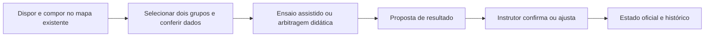

# 103 — Roteiro do instrutor: disposição das forças e confronto

**Elaborado em 2026-11-16; atualizado em 2026-11-17 pela entrega [108](108_ENTREGA_PAR_CPC_NO_MAPA.md).** O mapa definido é o ATLANTICADOR integrado ao SISCAN. Já permite organizar as forças e conferir um par AZUL/VERMELHO. **Execução de confronto por grupamentos e adjudicação de efeitos ainda não estão conectadas à tela.** “Preparar confronto” confere dados; não executa combate.

## O que está disponível e o que ainda falta

| Etapa | Situação |
|---|---|
| Plotar/reposicionar meios adjudicados no mapa | Disponível, com regras existentes |
| Criar, consultar, selecionar, enquadrar e arquivar grupamentos elegíveis | Implementado e verificado na prévia isolada da entrega 102 |
| Preparar dossiê inicial AZUL/VERMELHO com snapshots | Backend de 98 conectado à conferência gráfica em 108; referências iniciais, posições de planejamento e hashes separados |
| Executar ensaio temporal de dois grupamentos | Ainda não integrado; o ensaio CPC existente é de unidades individuais e parâmetros sintéticos |
| Reproduzir eventos do confronto no mapa | Concepção em 97; ainda não implementada |
| Julgamento didático, confirmação e aplicação oficial de efeitos nos meios | Requisitos definidos; integração própria ainda pendente |

Código instalado e processo ativo são coisas diferentes. A entrega gráfica pode ser conferida na prévia de teste; o servidor principal em 8787 não é reiniciado automaticamente. O roteiro pressupõe uma instância atualizada com as abas Grupos e CPC. A prévia de 108 usa dados sintéticos descartáveis, não os meios do exercício principal.

## Parte A — Passos que o instrutor já pode seguir na prévia

1. **Entrar com perfil de instrutor.** Conferir exercício e perfil antes de abrir o mapa. Se o seletor de partido estiver bloqueado em AZUL ou VERMELHO, a sessão é de operador; ela não permite organizar ou consultar livremente o adversário.
2. **Abrir o mapa ATLANTICADOR existente.** Usar a aba “Meios” do painel para consultar os meios adjudicados ao partido. Plotar por clique/coordenadas ou reposicionar pelas ferramentas anteriores quando necessário. Criar um grupo não posiciona os seus integrantes automaticamente.
3. **Escolher o partido no seletor “Partido SISCAN”.** O instrutor pode alternar AZUL/VERMELHO. Cada troca atualiza lista/realce; não junta inventários dos dois partidos. A seleção de grupo não é o agrupamento de camadas do editor.
4. **Abrir a aba “Grupos” (nome acessível: “Grupamentos”).** Em “Nova composição”, informar designação, domínio e integrantes elegíveis; acionar “Criar grupamento”. Unidade sem instância/snapshot/domínio demonstrado aparece pendente ou indisponível. O catálogo técnico completo não representa automaticamente unidades prontas para agrupamento; a integração atual reconhece a configuração aérea sintética controlada.
5. **Conferir o grupo criado.** Selecioná-lo na lista para realçar os marcadores já plotados. “Enquadrar integrantes” altera apenas a câmera. A lista mostra nomes/códigos do cadastro, posição disponível e pendências; clicar num integrante abre a consulta no painel. “Sem posição” não significa perda ou ausência de meio.
6. **Repetir para o outro partido.** Para liberar integrantes de um grupo, usar “Arquivar grupamento” e “Confirmar arquivamento”. Para recompor, arquivar e criar outro; não há edição gráfica dos membros. Na prévia de 108 já existem Grupo AZUL e Grupo VERMELHO, dispensando criar novas composições para a demonstração.
7. **Abrir CPC.** No mesmo painel lateral, selecionar explicitamente “Grupamento AZUL” e “Grupamento VERMELHO”. Nenhum grupo é escolhido automaticamente. Grupos incompatíveis ficam indisponíveis com motivo. O modo de consulta suspende as ferramentas de edição/plotagem.
8. **Acionar Preparar confronto.** O servidor reconfere autorização, exercício, revisões, snapshots, adjudicação e posições. Aguardar “Par conferido. Revisão do instrutor pendente.” Falha exige atualizar as fontes/corrigir a composição; não há preparação parcial.
9. **Conferir o par e enquadrar.** Usar “Enquadrar o par”; AZUL e VERMELHO aparecem juntos no mapa definido, sem mover os meios. Clicar no marcador ou no integrante abre suas referências no painel. Posição é de planejamento; configuração inicial não representa combustível/munição atuais. Dado desconhecido permanece não informado.
10. **Voltar ao planejamento.** A consulta é removida e a perspectiva autorizada é recarregada. Trocar seleção, atualizar fontes ou sair invalida a conferência anterior. Uma preparação não reserva recursos para uso futuro.

**Aqui termina o fluxo implementado.** Os grupos/histórico são temporários e se perdem ao reiniciar o servidor. Julgamento, confirmação e aplicação de perdas oficiais ainda não têm controles funcionais nesta tela.

## Parte B — Fluxo previsto para realizar o confronto

Os passos abaixo descrevem a experiência desejada, fundamentada em 80/81/97. **São etapas futuras, não botões já existentes.** Não substituem a especificação de execução/visibilidade/adjudicação que ainda precisa ser desenvolvida.

1. **Revalidar a preparação antes de executar.** A seleção/conferência já está entregue na Parte A. A etapa futura deve vincular a preparação aos estados operativos e recursos atuais, sem tratar uma captura antiga como reserva.
2. **Completar a situação inicial de execução.** Definir relação entre posições geográficas de planejamento e posições temporais do ensaio, estoques atuais e origem/unidades validadas. Ausências geram pendência; não substituir desconhecido por zero.
3. **Escolher a forma de adjudicação.** No modo assistido, o sistema executa apenas regras didáticas/modelos previamente definidos e apresenta uma proposta explicável. Na arbitragem didática direta, o instrutor registra os efeitos desejados para o exercício sem precisar aceitar ou executar um cálculo automático. Ambos precisam preservar justificativa e rastreabilidade.
4. **Acompanhar a apuração.** Quando a execução/reprodução estiver integrada, eventos registrados poderão ser consultados no mesmo mapa e numa linha do tempo: tempo, envolvidos e mudanças de estado/estoque. Animação só representa fatos existentes no registro; não inventa trajetórias ou dados de detecção. Voltar no replay não desfaz efeitos oficiais.
5. **Revisar a proposta e decidir.** Conferir estado inicial/final, combustível, munição, avarias/perdas propostas e pendências por meio. O instrutor poderá confirmar, ajustar ou rejeitar, registrando autoria e justificativa. **Resultado automático não vira resultado oficial por terminar o ensaio.**
6. **Aplicar e consultar o resultado oficial.** Somente após confirmação autorizada o backend publica efeitos rastreáveis, com controle de revisão e aplicação única. O mapa/ficha distinguem ensaio de estado oficial e preservam o histórico. O operador recebe somente o que sua visibilidade permitir.

A e B estão entregues para composição e conferência inicial, com as limitações de 108. C–F continuam futuros; não há execução ou resultado oficial de grupamentos disponível na interface.

## Como ler os indicadores quando forem integrados

Para superfície, preservar os limites confirmados: acima de 60% combater; de 40% a 60%, incluindo os limites, navegar; abaixo de 40% flutuar. O índice e as avarias confirmados pelo instrutor não são deduzidos de combustível ou munição.

Combustível: mínimo M definido pelo operador, sem padrão; pré-alerta fixo em M+5 pontos, vermelho em M ou menos. Percentual só com base/unidade validada. O indicador geral de armamento ainda exige método de agregação e definição do limiar: o exemplo de 30% não foi fixado como regra universal. Não somar tipos heterogêneos para fabricar o percentual.

Esgotamento: superfície/terrestre imobilizam; aeronave em voo tem perda proposta para adjudicação. Ficha de grupo não recebe média automática de poder ou estado dos integrantes. Estas regras orientam a integração futura; as três barras não foram implementadas pela aba de grupos.

## Próximo passo para o instrutor conseguir confrontar pela tela

Seleção do par e conferência inicial estão entregues em 108. Conforme a ordem de 104, faltam contratos de estado/adjudicação durável, julgamento didático, confirmação e aplicação única dos efeitos pelo instrutor. Ensaio temporal/replay por grupamentos exige integração própria. Manter o mesmo mapa e distinguir preparação de resultado oficial.
