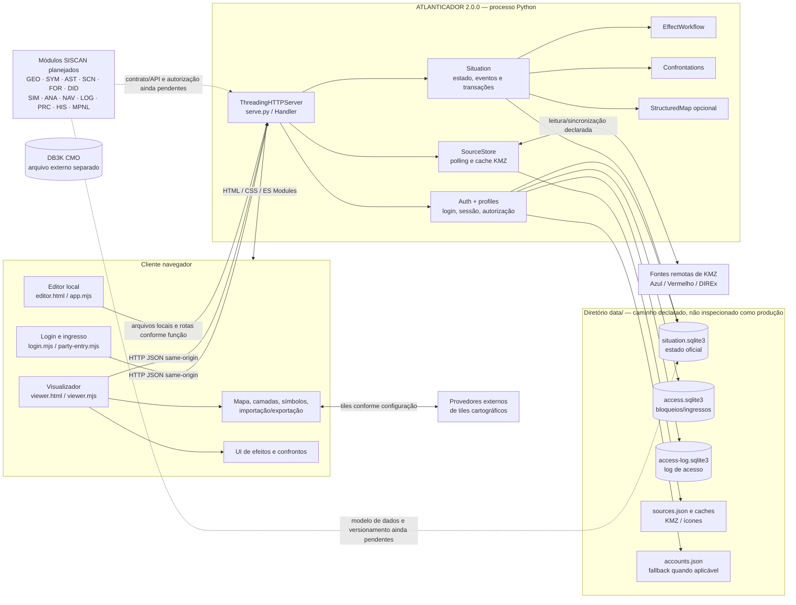

# 22 — Diagrama arquitetural do ATLANTICADOR

O diagrama representa componentes identificados estaticamente no ZIP. A caixa SISCAN e as ligações tracejadas são possibilidades conceituais, não integração implementada nem aprovada.

**Nota importante:** o diagrama mostra relações de software encontradas ou caminhos explicitamente declarados no código. O fluxo SISCAN está tracejado porque não existe integração identificada no ZIP. DB3K não tem aresta para ATLANTICADOR: não foi localizada conexão direta no código pesquisado. Nenhum serviço, endpoint ou banco foi iniciado nesta missão.
