# 38 — Arquitetura conceitual consolidada do SISCAN

**Classificação:** arquitetura conceitual de referência, aprovada como orientação com limites em 49 APR-06–APR-09; **não aprovada para implementação**. Consolida 17, 21, 23–28, 29–34, decisões 35, modelo 37 e resultado de aprovação 49. Nenhuma integração foi feita.

## Princípios e autoridades

- O SISCAN é ferramenta didática; SIM/PRC são abstratos, configuráveis, com hipótese explícita e decisão humana (35 DEC-001/018/019).
- **Aprovado conceitualmente (49 APR-06):** backend como autoridade sobre autenticação, autorização e persistência oficial; visão adversária bloqueada por padrão no primeiro protótipo e autorizável pelo instrutor sob controle do backend. Rascunhos locais não se tornam oficiais por si sós.
- **Aprovado conceitualmente (49 APR-07):** cinco domínios logicamente separados — cartográfico, didático, técnico, logístico e histórico — integrados por interfaces/regras controladas. Isso não exige bancos físicos separados.
- Adaptar ATLANTICADOR apenas após avaliação técnica, contratual e jurídica. ZIP 2.0.0 e bancos de dados declarados não equivalem a uma instalação operacional (16–34).
- DB3K não é banco do ATLANTICADOR nem esquema SISCAN; acesso direto no browser ou herança do schema não é proposto (04,20,27,37).

## Diagrama conceitual proposto

```mermaid
flowchart TB
  subgraph Client[Frontend — navegador]
    Shell[Navegação e componentes comuns]
    Geo[GEO viewer: mapa, camadas, geometria]
    Sym[SYM: catálogo/simbologia autorizada]
    Domain[AST · SCN · FOR: formulários e composição]
    Did[DID: exercício, submissão e avaliação]
    Sim[SIM · PRC: hipótese e adjudicação humana]
    Analysis[ANA · NAV · LOG · MPNL: análise, tempo e sustentação]
    History[HIS: trilha autorizada]
    Draft[Rascunhos locais isolados]
    Shell --> Geo
    Shell --> Domain
    Shell --> Did
    Shell --> Sim
    Shell --> Analysis
    Geo -. catálogo visual .-> Sym
    Domain --> Draft
    Did --> Draft
  end
  Client -->|interfaces documentadas por módulo — PROPOSTO| API[Backend SISCAN — autoridade]
  subgraph Services[Domínios de aplicação — proposta lógica]
    IAM[Identidade e autorização]
    Exercise[Exercício / cenário / submissão]
    GeoSvc[Dados e validação geográfica]
    Asset[Cadastro AST / FOR]
    Adjudication[SIM / PRC e decisão humana]
    Logistics[LOG / MPNL]
    Reporting[ANA / relatórios]
    Audit[HIS / eventos e auditoria]
  end
  API --> IAM
  API --> Exercise
  API --> GeoSvc
  API --> Asset
  API --> Adjudication
  API --> Logistics
  API --> Reporting
  API --> Audit
  Services -->|persistência segregada por domínio — PROPOSTO| Data[(Persistência oficial SISCAN)]
  GeoSvc --> GeoData[(Dados geográficos/versionados)]
  Exercise --> DidData[(Estado didático e submissões)]
  Logistics --> LogData[(Bases técnica, logística, econômica)]
  Audit --> HisData[(Histórico/auditoria)]
  Atlantic[ATLANTICADOR 2.0.0 — componentes/cartografia identificados]
  Geo -. avaliar adaptadores, licença e contrato .-> Atlantic
  DB3K[DB3K/CMO — fonte externa, sem equivalência]
  DB3K -. estudo de metadados e proveniência; sem vínculo físico presumido .-> Asset
```

O desenho mostra fronteiras lógicas. Não decide microserviços, tecnologia de banco, topologia, API concreta, schema ou implantação.

## Módulos e responsabilidades conceituais

| Módulo | Responsabilidade | Entrada/saída conceitual | Situação de componente |
|---|---|---|---|
| GEO | Visualizar e validar dados espaciais, CRS, máscara terrestre e margem aprovada | geometria/fonte/versionamento ↔ validação e apresentação | Leaflet/renderização ATLANTICADOR **identificados**, reutilização depende licença/contrato; máscara SISCAN a desenvolver/obter. |
| SYM | Catálogo, geração, proveniência e seleção de símbolos | identidade/configuração de unidade → representação visual | Uso do Calunga aprovado conceitualmente em 49 APR-15 conforme declaração do responsável; integração técnica não realizada. Manter módulo desacoplado da implementação interna. |
| AST | Modelo, configuração, plataforma, equipamento, sensor, unidade e procedência | dados técnicos validados ↔ instâncias SCN/FOR/LOG | Não há cadastro mestre SISCAN pronto; requer desenvolvimento conceitual e semântica DB3K. |
| SCN | Cenário, versões, período, fontes e premissas | AST/FOR/GEO → cenário versionado para DID | Editor ATLANTICADOR é draft local e não equivale a SCN; adaptar após decisão. |
| FOR | Composição de forças nos quatro níveis decididos | AST + hierarquia do ramo → composição de cenário | Modelo específico precisa ser desenvolvido; preserva 08. |
| DID | Exercício, papéis, submissão privada, avaliação e liberação | cenário/força → submissão/avaliação | Fluxos ATLANTICADOR são de partido/operação; isolá-los. |
| SIM | Registro de hipóteses, ações, eventos e adjudicação humana | estado didático + hipótese → decisão registrada/resultados | Backend/modelos ATLANTICADOR não aprovados como SIM SISCAN. |
| PRC | Indicador comparativo didático e configurável | critérios/fonte/hipóteses → indicador com limites | Fórmula não definida; não transferir cálculo de Confronto. |
| NAV | Relógio simulado, posição/deslocamento e histórico temporal | posição/velocidade/intervalo → estado temporal | Calendário ATLANTICADOR não é engine NAV; requer definição/desenvolvimento. |
| LOG | Consumo, autonomia, transferência e disponibilidade | AST + perfil consumo + NAV → registros de sustentação | Nenhum módulo logístico identificado; desenvolver conforme parâmetros aprovados. |
| MPNL | Necessidades bottom-up, estoques/manutenção/reposição e depois custo | dados LOG/AST e hierarquia → consolidação rastreável | Não encontrado no ATLANTICADOR; módulo independente de cartografia. |
| ANA | Consultas e relatórios de exercício/indicadores | DID/SIM/NAV/LOG/MPNL → resultados contextualizados | Painéis existentes não equivalem aos relatórios SISCAN; requisito de conteúdo pendente. |
| HIS | Trilha de eventos, mudanças, autoria, versões e liberação | eventos autorizados de domínios → histórico consultável | Padrões ATLANTICADOR identificados; políticas/contratos SISCAN pendentes. |

## Frontend, backend e persistência

Frontend proposto combina shell por perfil, adaptador de API, componentes cartográficos, telas de domínio e rascunhos explicitamente locais. O visualizador ATLANTICADOR pode ser preservado como referência visual/cartográfica; editor local, efeitos e telas de Confronto requerem avaliação, não adoção automática (33–34). A divergência `situation-ui` versus POST 410 em `events` reforça que endpoints internos não são contratos SISCAN (31).

Backend concentra autenticação/autorização, validação de negócio, versionamento oficial, submissões, avaliação e trilha; módulos se comunicam por interfaces conceituais versionadas (proposta em 39). Persistência separa pelo menos contextos lógicos de dados geográficos, estado didático, bases MPNL e histórico. O mecanismo físico fica pendente; JSON em SQLite do ATLANTICADOR não deve ser pressuposto como modelo final (20,27).

## Componentes ATLANTICADOR: destino de avaliação

- **Existentes/identificados:** viewer e editor Leaflet, ES Modules, cena/camadas/geometria, importação/exportação, Calunga, login, UI de efeitos/Confronto, backend HTTP/SQLite/KMZ.
- **Candidatos a adaptação:** visualização cartográfica, geometria/camadas, símbolos genéricos SVG, formatos geográficos, padrões de revisão e histórico, sujeitos à matriz 28/33, licenças e validação.
- **Não existentes como módulos SISCAN prontos:** MPNL bottom-up, cadastro AST/força nos níveis decididos, NAV naval, DID com privacidade didática, relatórios/PRC aprovados.
- **Isolar:** regras de partido/DIREx, efeitos, Confronto/modelos, schema de persistência, endpoints internos e diretório DB3K.
- **Reavaliar:** arquitetura física, identidade, contratos, tecnologia de persistência, fonte geográfica e licença.

## Limites de autoridade e dados

Estado local é rascunho; cenário publicado, exercício ativo, submissão liberada, decisão adjudicada, consumo e custo oficial são persistidos e autorizados pelo backend. GEO pode renderizar estado didático sobre mapa, mas não governa submissão/avaliação. MPNL consome dados identificados/provenientes e não toma valor de combate ou PRC como necessidade. HIS deve rastrear fonte, versão e ator. Alterações de cenário publicado durante a simulação são permitidas a instrutores/administradores após o aviso obrigatório e devem registrar autoria, data/hora, conteúdo, justificativa quando informada e histórico (49 APR-11).

## Pendências arquiteturais

Identidade, contratos, versionamento técnico, estrutura de dados, sincronização offline, cache, capacidade, backup e política de licenças permanecem pendentes. A implantação centralizada inicial e orientação híbrida futura são decisões conceituais; não equivalem a especificação executável. Esta arquitetura não autoriza implementação.
