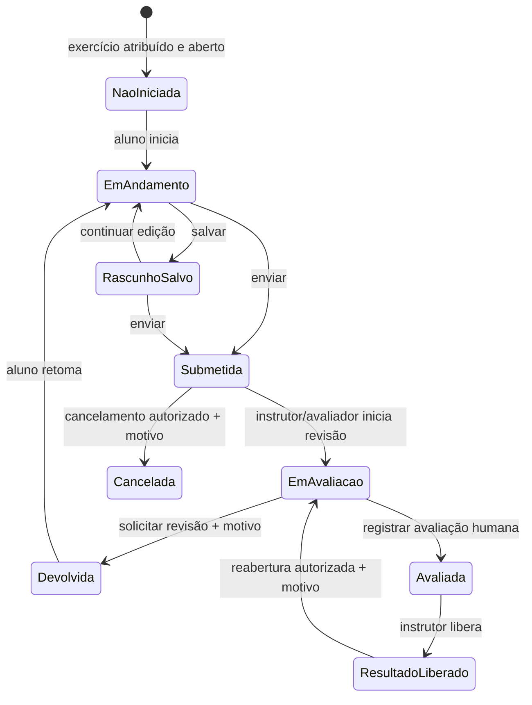

# 44 — Fluxo proposto de submissão e avaliação didática

**Status:** fluxo elaborado antes das decisões APR-03–APR-05. A autoridade do avaliador/instrutor, prazos, tentativas, preservação de versões e princípios de rubrica foram decididos com ressalvas em [49](49_REGISTRO_DECISOES_APR_01_A_APR_20.md). Detalhes de transição não aprovados expressamente continuam propostas. Avaliação é pedagógica e humana; nenhuma pontuação tática automática é autorizada.

## Estados conceituais

| Estado | Significado / quem pode agir |
|---|---|
| Não iniciada | Participante ainda não criou rascunho; exercício publicado e atribuído. |
| Em andamento | Participante iniciou atividade; edição do próprio conteúdo permitida conforme prazo/configuração. |
| Rascunho salvo | Conteúdo salvo sem submissão; visível ao autor e, conforme proposta, sem acesso de avaliação até envio. |
| Submetida | Entrega congelada como versão identificada; edição direta bloqueada; autor pode consultar recibo. |
| Em avaliação | Instrutor/avaliador atribuído revisa conteúdo e pode registrar comentário em andamento. |
| Devolvida para revisão | Avaliador fornece fundamento/comentários; aluno pode criar revisão que referencia a submissão anterior. |
| Avaliada | Avaliação humana concluída e ainda não liberada ao aluno. |
| Resultado liberado | Instrutor publica avaliação no escopo definido; conteúdo visível aos destinatários autorizados. |
| Encerrada/cancelada | Estado terminal de exercício ou submissão; política de recuperação/retificação pendente. |

## Transições propostas

Uma nova submissão depois de devolução cria nova revisão/versionamento vinculado à anterior; não sobrescreve o histórico. Após liberação, correção exige reabertura explícita e evento de auditoria. Se prazo expirou, o comportamento (bloquear, permitir atraso, extensão) depende de configuração aprovada.

## Regras de transição

| Ação | Ator proposto | Pré-condições | Registro e efeito |
|---|---|---|---|
| Iniciar | Aluno atribuído | Exercício aberto; participante ativo | Cria atividade em andamento e associa cenário/versionamento. |
| Salvar | Aluno autor | Estado editável e dentro das regras de prazo | Atualiza rascunho privado; não altera catálogo/cenário. |
| Submeter | Aluno autor | Campos/requisitos obrigatórios completos; dentro do prazo ou exceção aprovada | Cria versão imutável da entrega com autor, hora, versão-base e confirmação. |
| Iniciar avaliação | Instrutor/avaliador designado | Submissão atual não liberada e avaliador autorizado | Marca em avaliação; grava avaliador e data. |
| Devolver | Instrutor/avaliador permitido | Avaliação em andamento e motivo obrigatório | Marca devolvida; feedback privado; mantém versão submetida. |
| Reenviar após devolução | Aluno autor | Revisão autorizada e ainda dentro do prazo ou prazo prorrogado | Nova revisão que referencia a anterior; versão anterior preservada. |
| Concluir avaliação | Instrutor/avaliador atribuído | Rubrica/critério exigido preenchido | Avaliação humana assinada; fica pendente de liberação. |
| Liberar resultado | Instrutor responsável | Avaliação concluída; destinatários definidos | Registra ato, autor, instante e escopo; habilita leitura autorizada. |
| Reabrir/corrigir | Instrutor responsável | Motivo e destinatários notificados conforme política | Nova revisão; não apaga resultado previamente liberado. |
| Encerrar exercício | Instrutor | Política de pendências definida | Impede novas alterações; histórico continua consultável conforme retenção. |

## Prazo, tentativas, justificativa e rubrica

- **Prazo:** recomenda-se configurável por exercício, podendo ficar sem prazo se o instrutor assim definir; a existência de prazo obrigatório não está decidida. Política para atraso/extensão precisa de aprovação.
- **Tentativas:** não fixar número universal. Recomenda-se que instrutor configure limite ou escolha ilimitado/revisão; devolver cria nova revisão sem eliminar a anterior.
- **Data/hora:** registrar timestamps de criação, edição relevante, submissão, avaliação, devolução, liberação e reabertura. Fuso/formato e política de sincronização requerem decisão técnica.
- **Justificativa:** incluir campo obrigatório na submissão e justificativa de decisão pertinente ao objetivo pedagógico. Critério mínimo e limites de conteúdo pendentes.
- **Comentários:** separar feedback privado ao autor de comentário destinado a todos; visibilidade precisa ser escolhida por comentário.
- **Rubrica:** configurar critérios humanos e descrição de evidência; não converter automaticamente decisão tática em acerto/erro. Indicadores, escala/pesos e vínculo com PRC pendem de aprovação acadêmica.
- **Alteração pós-envio:** bloquear edição da versão submetida; reabrir/devolver e gerar revisão nova, com histórico preservado.

## Privacidade e auditoria

Antes da liberação, somente autor e avaliadores/instrutor explicitamente atribuídos podem acessar conteúdo de submissão. Relatórios, busca, API, cache, exportações e UI devem aplicar a mesma política. O backend valida cada transição/permissão. Registro de eventos recomendado: ator, instante, exercício, submissão/revisão, ação, motivo e escopo de liberação. Retenção e acesso administrativo ainda são pendentes.

## O que não será automatizado

Esta proposta não introduz decisão automática sobre emprego de força, avaliação tática automática, cálculo determinístico de vitória, recomendação de armas ou nota inferida por modelo. Ferramentas de apoio, se futuramente aprovadas, devem mostrar hipóteses e permitir julgamento humano documentado.
