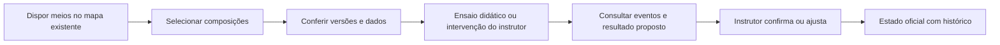

# 97 — Disposição das forças e visualização do confronto

**Data: 2026-11-16. Estado: concepção proposta, sem implementação gráfica.** Pedido do responsável: começar a pensar na interface da disposição das forças e na apresentação gráfica do confronto. **Restrição expressa confirmada:** usar o mapa já definido do ATLANTICADOR integrado ao SISCAN. Não substituir mapa, bibliotecas ou ferramentas existentes nem criar mapa independente.

Base: entregas 76–78, decisões de confronto/indicadores 80–81, registro de grupamentos 93 e preparação proposta 94–96. Inspeção desta etapa foi documental e de código: `map_units.py` e inventário dos arquivos estáticos. Não houve inspeção visual do navegador ou teste desta proposta; não se afirma que ela já aparece no sistema. Skills aplicadas: Spec Driven Development, Ponytail e Frontend UI Engineering.

## Experiência proposta no mapa existente

Preservar projeção, camadas, controles, ferramenta de plotagem e reposicionamento já disponíveis. Acrescentar o modo CPC ao mesmo ambiente, reaproveitando o painel lateral original para uma única tarefa de cada vez. Uma barra de tempo recolhível ocupa a borda inferior somente durante consulta de ensaio/reprodução; ficha detalhada ocupa o painel, sem abrir janelas flutuantes sobrepostas.

```text
┌──────────────────────────────────────────────────────────────────┐
│ Cenário · Modo: Planejamento / CPC · Situação: Proposta / Oficial │
├─────────────────┬────────────────────────────────────────────────┤
│ Painel existente│ MAPA ATLANTICADOR EXISTENTE                     │
│ Uma aba ativa:  │ Meios, apoios e camadas já definidos            │
│ • Composição    │ Seleção realça membros do grupamento            │
│ • Meio          │ Evento selecionado realça os envolvidos         │
│ • Eventos       │ Hover compacto; detalhes no painel              │
│ • Resultado    │ Sem inventar posições para meios não plotados    │
├─────────────────┴────────────────────────────────────────────────┤
│ Reprodução: início · evento anterior/próximo · tempo · eventos    │
└──────────────────────────────────────────────────────────────────┘
```

É um esquema de interação, não novo frontend pronto ou layout validado. Em tela estreita, o painel deverá recolher e abrir como uma única área de consulta, preservando o acesso aos controles. Dimensões e comportamento responsivo serão verificados em protótipo posterior.

## Disposição e composição

O operador continua plotando seus meios por clique, coordenadas ou referência de apoio e reposicionando pelas ferramentas existentes. Seleção por área/lista deve oferecer alternativa por teclado. Uma composição usa somente unidades adjudicadas ao partido: agrupar não cria unidade, move o conjunto automaticamente ou duplica estoques.

Clicar no grupamento realça seus integrantes e abre a lista no painel, com código/nome iguais ao cadastro e referência da revisão. Se houver marcador de grupo em zoom distante, será apenas resumo visual dos membros, sem nova posição física ou unidade de combate. Expandir deve voltar aos marcadores individuais. Agregação visual fica proposta, não altera MPNL nem calcula poder médio.

Meio não plotado aparece na lista como “Sem posição”. Não posicionar em (0, 0), no centro do grupo ou em uma base presumida. Associação a base/apoio depende do vínculo validado pelo backend. As posições atuais do mapa são de planejamento; sua ligação a posições temporais do ensaio ainda precisa de contrato explícito, com IDs e revisão da posição, sem misturar coordenadas geográficas com o plano local sintético do CPC.

## Como mostrar o confronto

Fluxo proposto, dependente das futuras integrações:



Na preparação atual só existe o registro de 93; o dossiê de dois partidos ainda será implementado pelas tarefas de 96. Ensaio de grupamentos, reprodução no mapa e aplicação oficial são etapas futuras distintas. O modo didático direto permite registrar a decisão do instrutor sem exigir resultado automático prévio.

Quando houver ensaio integrado, a interface deverá reproduzir eventos efetivamente registrados, com identificação do ensaio, versão e tempo simulado. Selecionar evento realça as unidades envolvidas e apresenta antes/depois no painel. Movimento usa posições registradas; marcador de detecção, disparo ou impacto deve dizer que é evento do ensaio, sem simular trajetória, posição de impacto ou duração que o motor não forneceu. Efeitos visuais são opcionais e reduzíveis, sem explosões decorativas apresentadas como evidência física.

Controles de reproduzir, pausar, voltar e avançar consultam o histórico. Voltar no tempo não desfaz consumo ou resultado oficial. Velocidade de reprodução muda apenas a apresentação; não avança relógio do motor nem dispara novas ações. Se futuramente houver botão para executar novo passo, deve ficar separado e claramente identificado.

Usar distinção por rótulo e estilo entre **planejamento**, **ensaio/proposta** e **estado oficial**; por exemplo, realce tracejado para proposta e indicação textual do estado confirmado. Nunca pintar perda proposta como destruição oficial. O instrutor poderá comparar antes/depois, ajustar e confirmar em fluxo próprio com motivo/autoria/histórico. Esse fluxo depende de backend autorizado e idempotente; animação não publica efeitos.

## Ficha compacta do meio

Hover breve também disponível por foco de teclado/toque, sem janela grande. Mostrar identificação, partido autorizado, disponibilidade conhecida e três indicadores, quando sua base for válida:

| Indicador | Regra a preservar |
|---|---|
| Estado operativo | Para superfície: acima de 60% combater; 40%–60% inclusive navegar; abaixo de 40% flutuar. Texto e percentual junto da cor; não inferir avaria por combustível |
| Armamento | Um resumo visual, preservando estoques detalhados na ficha expandida; método de agregação/denominador e limiar ainda dependem da especificação de 81. Não fixar 30% universal |
| Combustível | Mínimo M escolhido pelo operador; acima de M+5 verde, M < F ≤ M+5 laranja, F ≤ M vermelho. Margem fixa de 5 pontos percentuais, sem mínimo padrão |

Valor desconhecido aparece “Não informado”. Percentual exige denominador/unidade validado; não converter silenciosamente os mínimos absolutos já cadastrados. Condição de origem do instrutor e restrição por recursos devem permanecer distinguíveis. Combustível zero imobiliza superfície/terrestre; perda aérea em voo pertence ao resultado do ensaio/adjudicação, conforme 87.

Detalhes técnicos, foto quando houver referência disponível, estoques por tipo e histórico ficam no painel após clique. A ficha da força lista integrantes/condições conhecidas, sem média de estado ou probabilidade de vitória inventada. Padronização/silhuetas existentes podem ser refinadas depois; trocar iconografia não bloqueia o backend.

## Visibilidade e limites

Instrutor autorizado pode consultar ambos os partidos. Operador vê seu partido e apenas os contatos/informações adversárias que o provedor autorizar; o mapa não recebe a composição completa inimiga para escondê-la por CSS. Reprodução e relatórios também devem respeitar visibilidade. Regras de contato não são deduzidas de distância visual ou camada ativada.

Evitar depender só de azul/vermelho: combinar partido, símbolo, contorno e texto. Distinguir seleção do cursor de estado operativo e condição de perda. Prever foco visível, alternativa sem arrastar e preferência de movimento reduzido.

## Próximos recortes e verificação necessária

1. Concluir a preparação do backend de 94–96 sem ampliar seu escopo.
2. Especificar uma primeira fatia gráfica no mapa existente: selecionar composição e consultar seus integrantes/versões, sem executar confronto. Conferir a ligação entre identidade de inventário, `unit_id` e `asset_id`, sem depender do nome.
3. Especificar depois reprodução de ensaio, contratos temporais/geográficos, visibilidade e confirmação oficial, por capacidades existentes. Não criar um módulo paralelo de mapa ou um segundo motor de combate.

Antes de declarar interface entregue: verificar no navegador real que mapa/ferramentas anteriores permanecem; não há painéis sobrepostos; seleção e hover funcionam com teclado/toque; consultas não vazam outro partido; proposta e oficial são distintos; replay não altera recursos; ausência de posição/dados é explícita. Testar com dados isolados e sem mover os meios do usuário.

Questões ainda abertas: posições do ensaio versus planejamento, política de contatos por partido, campos de agregação do armamento e publicação oficial de efeitos. Esta concepção não decide esses contratos nem implementa layout ou resultados. O uso do mapa existente é requisito confirmado, não questão aberta.
