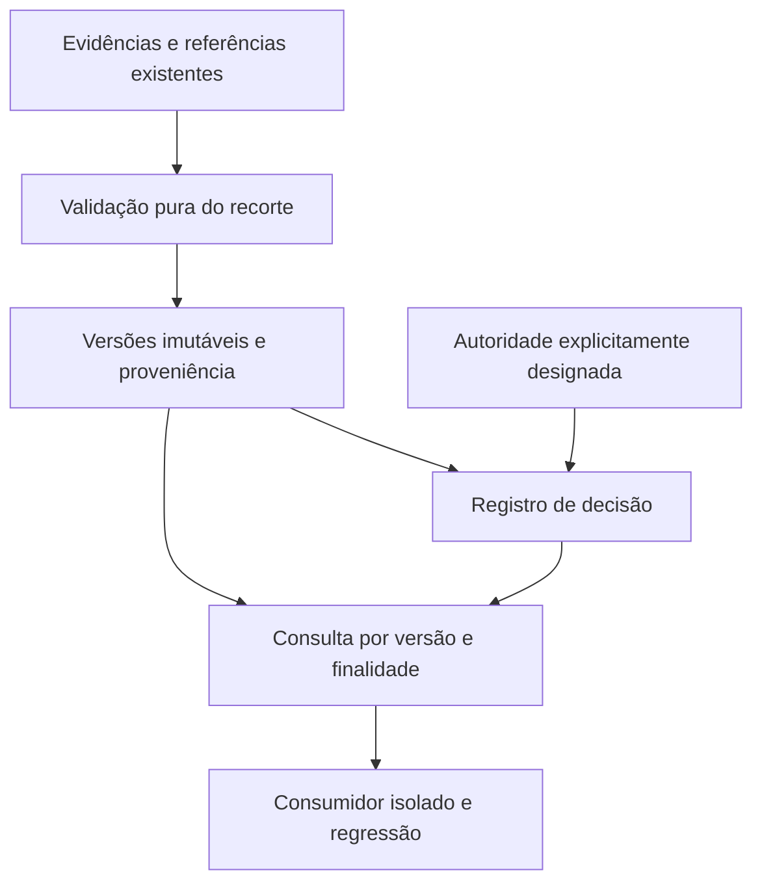

# Plano técnico: technical-catalog

**Estado: Fase 2 aprovada em 2026-11-11**, por resposta expressa “sim” do responsável após apresentação do plano. Mapa e especificação foram aprovados em interações anteriores. Tarefas de Fase 3 propostas para revisão em [todo.md](todo.md), sem implementação iniciada. A aprovação não homologa atributos Command nem designa contas reais.

## Resultado pretendido

Adicionar ao backend existente uma camada de consulta que entregue um perfil técnico versionado apto a uma finalidade explícita ou recuse o uso com motivos verificáveis. Primeiro recorte: combustível/consumo aéreo por regime/faixa/configuração. Conservar os dados literais e todas as barreiras atuais. Prioridade: comprovar os caminhos de recusa e a ausência de efeitos no exercício antes de habilitar qualquer promoção real.

## Inspeção de partida e reaproveitamento

| Componente existente | Uso no plano |
|---|---|
| `tools/compile_db3k.py`, `source_catalog.py`, `resource_store.py` | Consultar fontes derivadas e vínculos já recuperados; não compilar tudo novamente |
| `tools/register_source_references.py` | Reutilizar proveniência/UUIDs de referência; manter o escopo literal existente sem ampliá-lo |
| `tools/import_technical_values.py` | Preservar as tabelas atuais: `unit` só aceita NULL e status é fixado em `pending_unit_and_semantics` |
| `technical_units.py` | Manter indicação de evidência/unidade candidata; não transformar metadado de apresentação em autorização de cálculo |
| `engine_input.py` e fixtures existentes | Preservar a entrada sintética atual; consumir o novo contrato em testes isolados, sem trocar a fonte da execução em uso |
| `app.py` | Reaproveitar autenticação, autorização, CSRF e padrões transacionais para eventual interface de aprovação; não conceder nova autoridade pelo papel de instrutor |
| `check_*.py` | Manter regressão e acrescentar os novos casos do contrato no mesmo padrão |

Ponto crítico confirmado no código: as restrições de `catalog_technical_values` impedem aprovar esses registros em lugar. O plano propõe uma camada **aditiva**, separada, mantendo as evidências brutas intactas. Não remover esses CHECKs para acomodar valores normalizados.

## Componentes e responsabilidades propostas

1. **Leitor de evidências do recorte:** referências existentes, hashes, linha/campo literal, configuração/instalação, regime/faixa e limitações. Não altera fonte nem inventa correspondência nominal. Referência a entidade externa continua separada de unidade física SISCAN.
2. **Validador puro:** verifica completude, unidades, escala, domínios, base por motor/conjunto, combustível e condições de configuração. Retorna razões estruturadas. Não aprova, interpola ou calcula trajetória/estoque. Transformações exigem regra identificada e demonstrada.
3. **Repositório de versões:** proposta de registros imutáveis de perfil, atributos/evidências associados e decisões, em tabelas adicionais no banco SISCAN. Armazenar versão, conteúdo canônico/hash, contexto, autor e instante. Definição SQL/migração concreta será revisada antes de execução; este plano não a executa.
4. **Autoridade de aprovação:** proposta de vincular a autoridade a contas autenticadas explicitamente designadas pelo responsável, reaproveitando sessões existentes. Nenhuma conta é designada por padrão. `approved_by` fornecido no pedido ou nome em arquivo não basta como autenticação dessa autoridade. Esse mecanismo ainda exige confirmação específica; nenhuma atribuição de conta é inferida da aprovação deste plano.
5. **Consulta de elegibilidade:** devolve versão exata, atributos/unidades, condições, decisão e finalidade ou razões de recusa. O consumidor nunca recebe a versão mais recente silenciosamente nem um perfil real elegível sem aprovação compatível.

Não criar microserviço, framework, fila ou mecanismo criptográfico próprio. A localização exata de funções novas será decidida na Fase 3, favorecendo um módulo pequeno para validação/consulta e os utilitários existentes para leitura. Interfaces novas permanecerão internas até comprovar o contrato; exposição HTTP fica restrita ao necessário e à autorização definida.

## Grafo e ordem de construção

### Fatia 1 — Diagnóstico de elegibilidade sem promoção

Percurso completo: referência existente → evidências do recorte → motivos de completude/recusa → teste do contrato. Começar por casos sintéticos e reais pendentes, sem persistir aprovação ou alterar `calculation_ready` existente. Verificar TC-01–04, TC-06 e TC-11. Qualquer sucesso sintético é identificado como teste, sem elegibilidade operacional Command.

**Checkpoint A:** recorte rastreável, recusas específicas e fontes preservadas. Antes da persistência, revisar o desenho aditivo e a correspondência entre referência/configuração/perfil. A falta de amostra real comprovada não é preenchida por inferência.

### Fatia 2 — Publicação de versão técnica sem liberação operacional

Percurso: evidência/validação → versão imutável pendente → consulta dessa versão. Acrescentar persistência aditiva, FK, unicidade e transação. Registro repetido não duplica; valor/evidência/contexto diferente gera nova versão pendente. Histórico é preservado. Verificar TC-01, TC-05, TC-08–09 e TC-11–12.

**Checkpoint B:** backup/restauração de teste, migração apenas em cópia isolada, integridade e comparação dos registros anteriores; rollback com falha injetada. Revisão da autoridade antes de qualquer aprovação real.

### Fatia 3 — Decisão autorizada e consulta de uso

Percurso: conta explicitamente autorizada → decisão vinculada ao hash/versão/finalidade → consulta elegível ou recusada. Demonstrar autorização usando contas/valores fictícios em base isolada. Em dados reais, permanecer bloqueado até resolução da identidade do responsável, evidências físicas e critérios de comparação. Verificar TC-05–10 e TC-12; não reinterpretar aprovação de identificação literal como aprovação operacional.

### Fatia 4 — Integração controlada com consumidor

Consumidor de teste solicita versão/contexto explícitos e aceita apenas contrato íntegro e elegível. Demonstrar troca de evidência, aprovação fora do escopo e ausência de dados obrigatórios como recusas. Não conectar automaticamente dados reais à execução em uso, adjudicar unidades ou aplicar consumo. Conferir todos os TC-01–12 e a regressão existente.

**Checkpoint C:** cadeia referência → atributo → evidência → versão → decisão → consumo do contrato reproduzível, com ausência comprovada de efeitos no exercício. O termo “consumo do contrato” aqui significa leitura pelo consumidor de software, não débito de combustível.

## Sequenciamento e trabalho independente

Validador precede publicação de versão; versão precede decisão; decisão precede elegibilidade real. Investigação de evidência física e desenho de casos negativos podem progredir independentemente do código de validação. Mudanças no mesmo schema, contrato ou registro de aprovação são sequenciais. Não há delegação ou execução paralela iniciada por este plano.

Validação semântica e aprovação não são fundidas numa flag. A verificação de todas as condições pode ser positiva tecnicamente enquanto o uso operacional continua recusado por ausência de decisão válida.

## Verificação planejada

Executar os comandos documentados na especificação, em base isolada: verificadores de unidades, persistência de recursos, importação técnica, referências e contrato sintético. Executar a suíte `check_*.py` antes de entregar cada mudança de backend. Novos verificadores devem seguir o mesmo padrão e fazer parte dessa suíte. Os comandos novos específicos serão escritos com as tarefas e deverão existir antes de serem marcados como executados.

Verificar preservação por hashes de fontes e comparação bidirecional de linhas anteriores; integridade SQLite/FKs; decisão/versão idempotentes; falha injetada revertendo tudo; pedidos concorrentes sem sobrescrita silenciosa. Leituras não criam aprovação. Testes de autorização incluem instrutor não designado, cliente forjando autor, sessão ausente e pedido fora do escopo.

Testes físicos exigem amostra e evidências independentes. Tolerâncias são por quantidade e finalidade, fundamentadas em fonte; divergência sem critério aprovado permanece pendente. Não fixar margem universal nem chamar igualdade entre duas cópias da mesma fonte de calibração independente.

## Riscos e mitigação

| Risco | Mitigação |
|---|---|
| Unidade exibida tomada como unidade SQL | Campos separados e recusa até comprovar escala/base |
| Aprovação antiga liberar contexto novo | Hash/versão/finalidade exatos e ausência de herança automática |
| Nova camada contornar os CHECKs do bruto | Preservar tabelas atuais, desenho aditivo e regressão de fontes/valores |
| Escolha arbitrária de aprovador | Nenhuma designação padrão; confirmação explícita da autoridade autenticada |
| Dependência de dados reais atrasar tudo | Casos sintéticos controlados para software; manter pendência física visível |
| Projeto crescer além do necessário | Recorte aéreo primeiro, funções/utilitários existentes e sem reformulação visual |
| Migração alterar exercício em uso | Backup consistente, cópia isolada, comparação de registros e revisão antes da entrega |

## Pendências que o plano não resolve por presunção

- O mecanismo de autoridade por conta explicitamente designada foi aceito com o plano; identificar a conta e registrar a designação antes de ativá-lo. Não promover a conta demonstrativa `instrutor` automaticamente.
- Selecionar a amostra real e obter evidências da escala, base da taxa e configuração; conjunto candidato não significa conjunto aprovado.
- Determinar critérios/tolerâncias com evidência antes de homologar dados reais.
- Revisar o desenho SQL/migração concreto antes de aplicá-lo. Nenhuma alteração de schema foi feita nesta fase.

## Próximo gate

Gate de Fase 2 satisfeito. Revisar as tarefas detalhadas em `tasks/todo.md`, com aceite, comandos, dependências e até cinco arquivos previstos por tarefa. Só após aprovação da Fase 3 haverá implementação. Gates específicos de SQL, designação de autoridade e homologação física continuam explícitos. Nenhum código, banco, dependência ou servidor foi alterado nesta fase documental.
